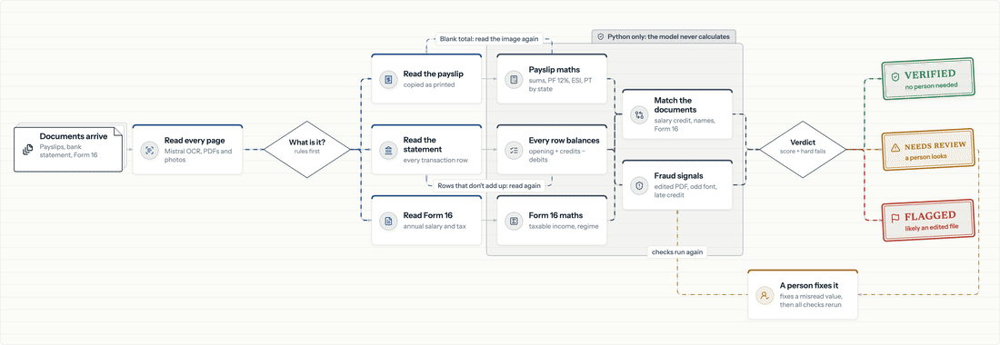
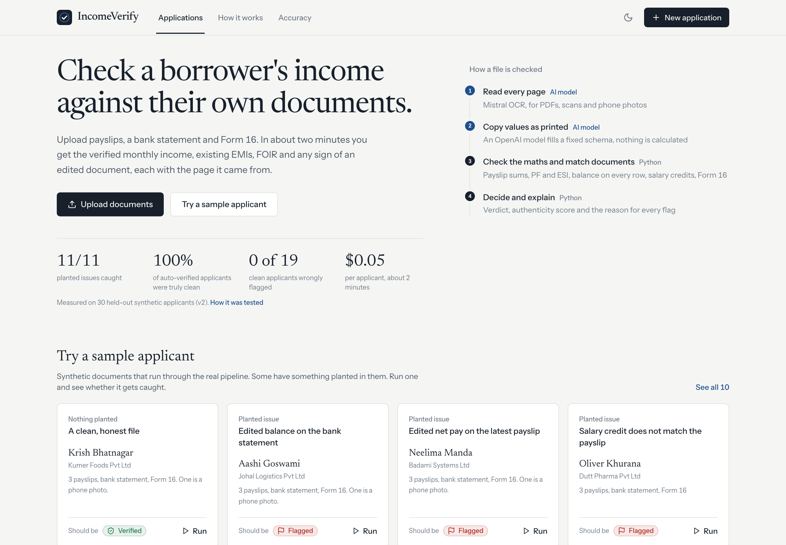
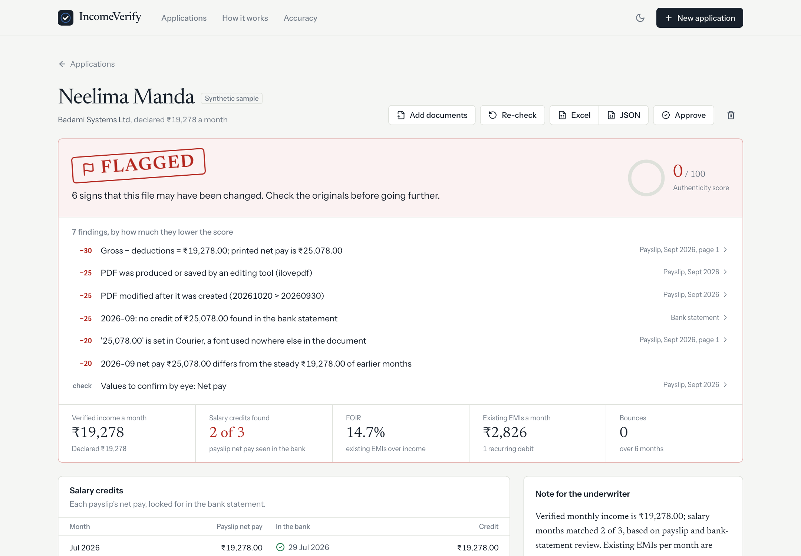
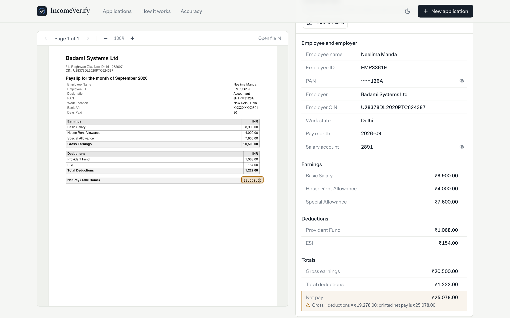
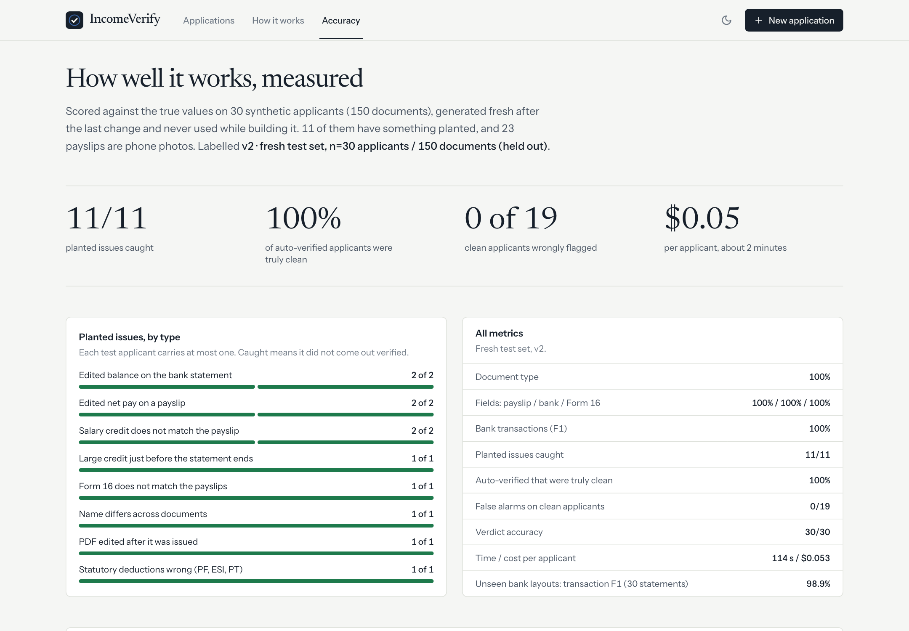
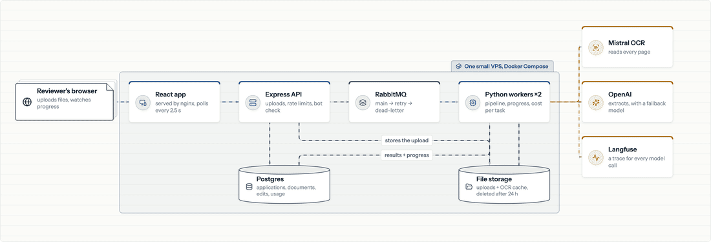

# IncomeVerify

**Loan income verification from payslips, bank statements and Form 16.** Upload a borrower's documents and in
about two minutes get the verified monthly income, existing EMIs, FOIR, bounces and an authenticity score, with a
verdict (Verified / Needs review / Flagged) where every finding points to the page it came from.

**The rule that makes it trustworthy: an AI model only reads the documents. Every sum, match and decision is
plain Python.** The model never calculates, so every number can be traced and checked.

Live demo: *coming soon* · Demo video: *coming soon* · Synthetic data only



| | |
|---|---|
|  |  |
|  |  |

## The problem

Before lending to a salaried borrower, an underwriter at a bank, NBFC or fintech checks their income by hand:
do the payslip numbers add up, did that salary really reach the bank, what EMIs are already being paid, does
Form 16 agree with the payslips. It takes hours per file, and edited documents still get through: net pay
inflated in a PDF editor, a large credit dropped in just before the statement ends, a "salary" that never
appears in the bank.

## What it checks

| Within each document (Python) | Across documents (Python) | Fraud signals → authenticity score |
|---|---|---|
| Payslip: earnings and deductions add up, gross − deductions = net | Each payslip's net pay arrives as a salary credit in the bank | PDF saved by an editing tool, or modified after it was created |
| PF ≈ 12% of basic, ESI only when gross ≤ ₹21,000, professional tax by state | Applicant, employee and account-holder names match | An amount set in a font used nowhere else on the page |
| Bank statement: the running balance on every row, and opening + credits − debits = closing | Employer matches the declared employer | Most credits round thousands |
| Form 16: taxable income from its parts, regime and standard deduction | Form 16 gross ≈ 12 months of payslips | A large credit in the last days of the statement |
| | | Money credited and sent straight back out |
| | | Only the latest payslip changed |

Plus metrics (verified monthly income, EMIs, bounces, FOIR, average and lowest balance, cash-deposit share), a
note for the underwriter written by a small model from the computed facts (rejected if it contains a number that
isn't in them), a review screen that shows the original page beside what was read, with corrections logged and
the file re-checked, and Excel / JSON export.

## Results

**v2 on a fresh held-out test set:** 30 synthetic applicants, 150 documents (90 payslips, 23 of them phone
photos), generated after the last change and never used while building. 11 carry a planted issue, across all
8 issue types.

| Metric (`v2 · n=30`) | |
|---|---:|
| Document type / payslip, bank, Form 16 fields | 100% / 100%, 100%, 100% |
| Bank transactions F1 | 100% |
| Planted issues caught | **11 / 11**, every type |
| Auto-verified applicants that were truly clean | **100%** |
| Clean applicants wrongly flagged | **0 / 19** |
| Straight-through (clean → verified, no person) | 100% |
| Verdicts right | 30 / 30 |
| Time per applicant p50 / p95 | 114 s / 132 s |
| Cost per applicant (OCR + LLM) | **$0.053** |
| **Unseen real-layout scanned bank statements** (30, 4,841 rows) | **98.9%** transaction F1 |

**v1 → v2.** v1 flagged 2 of 19 clean applicants: phone-photo payslips where OCR lost the table, and a blank
total was read as broken maths. v2 treats "couldn't read" as a warning, never as tampering, and reads blank
totals again from the page image (only blanks: a total that's present but wrong may be an edit). False alarms
went from 2/19 to 0/19 and straight-through from 89.5% to 100%.

**What each part is worth** (ablations on the v1 test set):

| Variant | Issues caught | Straight-through | Cost / applicant |
|---|---:|---:|---:|
| Mistral OCR + gpt-6.1-terra (used) | 11/11 | 89.5% | $0.050 |
| Cheaper extractor (gpt-6-luna) | 11/11 | 89.5% | $0.012 |
| Stronger extractor (gpt-6.1-sol) | 11/11 | 89.5% | $0.093 |
| PDF text layer instead of OCR | 9/11 | 21.1% | $0.030 |

The extraction model isn't the bottleneck; OCR is worth paying for (without it every photo and scan is unreadable).

**Limits, said plainly:** the data is synthetic, and the generator and the pipeline were written by the same
person, so 100% means "handles every layout and issue the generator makes". The external set of real-layout
statements is the check against that. With n=30, one more error moves a headline number by about 3 points.

Full reports: [`evals/results/report.md`](income-verify-ml/evals/results/report.md) (v2) and
[`v1-report.md`](income-verify-ml/evals/results/v1-report.md) (ablations, external set, error analysis).

## Architecture



- **React (Vite, Tailwind)** for upload, live progress, the decision sheet, and a review screen that renders the
  original with pdf.js and boxes the value you click.
- **Node / Express API**: uploads checked by content, rate limits, a Cloudflare Turnstile bot check on anything
  that starts paid work, and retention (files deleted after 24 h). It never runs a model.
- **RabbitMQ**: one small `{task, id}` message per document, plus one per application once its documents are read.
  Failed tasks go main → retry (15 s delay) → dead-letter, with the row marked failed.
- **Python workers**: Mistral OCR (cached by file hash) → classify → OpenAI extraction → checks → signals →
  confidence → verdict. They write results, progress and cost per task to Postgres, which the page polls.

## Reliability and load

- **Model calls:** one client for every call, with retries and backoff, then one round on a fallback model
  (terra ↔ sol) if the main one is down. A reply cut off for length is never retried on another model; the input
  is split in half instead.
- **Tracing:** every call can go to Langfuse with its name, model, tokens, cost and latency (on when keys are set).
- **Second reads:** bank rows that break the balance chain and payslip totals left blank are read again by a
  *different* model, and kept only if the arithmetic then agrees.
- **Load test** (one laptop, [`loadtest/results.md`](loadtest/results.md)):

| | |
|---|---|
| API, 50 users polling every 1–2 s | p95 **15 ms**, 0 errors |
| API stress, 100 users with no pause | **~1,760 requests/s**, p95 89 ms, 0 errors |
| Pipeline, 10 applicants at once, 2 workers | 10/10 verdicts right, throughput **~50 applicants/hour** |

Throughput is set by the number of workers (the work waits on OCR and model APIs, not CPU). One known weakness:
the queue is first in, first out by document, so in a burst every applicant waits for the whole burst. Finishing
one file before starting the next is the next fix.

## Design decisions

- **The model reads, Python decides.** Extraction copies values exactly as printed into a fixed schema; Python
  turns them into numbers and does every check. A wrong answer is then a misread (visible on the review screen),
  never an invented calculation.
- **Evidence over verdicts.** Each flag carries its reason, document and page. The authenticity score is 100
  minus the weight of each kind of signal that fired, so it's explainable line by line.
- **Unreadable ≠ tampered.** Blank values are warnings that send a file to a person; only a value that is
  present and wrong counts against authenticity.
- **Cheap where it doesn't matter, strong where it does.** A small model classifies (only when keyword rules
  aren't sure), categorises leftovers and writes the note; a stronger one extracts; a different one re-reads.
- **A queue between the API and the models,** so slow files and API outages never block the page, and every task
  can be retried and costed.

## Run it

Needs Docker, an OpenAI key and a Mistral key in the repo-root `.env` (`OPENAI_API_KEY`, `MISTRAL_API_KEY`).

```bash
cd projects/income-verify
# sample applicants for "Try a sample" (synthetic; 10 applicants, a few planted issues)
cd income-verify-ml && python -m venv .venv && .venv/bin/pip install -r requirements.txt
.venv/bin/python -m data_gen.generate --split dev --count 10 --seed 1 && cd ..
docker compose up -d --build        # UI http://localhost:5921 · API :5920
```

Postgres runs on 5434 and RabbitMQ on 5674 (management UI on 15674), so they don't clash with local installs.
Each service also runs from source; see the READMEs in
[`income-verify-ml`](income-verify-ml/README.md), [`income-verify-backend`](income-verify-backend/README.md) and
[`income-verify-frontend`](income-verify-frontend/README.md). Tests: `python -m unittest discover tests` (36,
offline) and `npm test` in the backend (21).

```
income-verify/
├── income-verify-frontend/   React app (pages, review viewer, theme)
├── income-verify-backend/    Express API, migrations, upload guards, Turnstile
├── income-verify-ml/         worker, pipeline, checks, data generator, evals
├── loadtest/                 k6 API test, pipeline batch test, results
├── docs/diagrams/            flow + architecture (HTML, PNG, SVG, MP4, GIF)
├── docs/screenshots/
├── infra/rabbitmq/           exchange, queues, retry and dead-letter
└── docker-compose.yml
```

## Next

- Finish one application before starting the next in a burst (per-application priority on the queue).
- Measure throughput with more workers.
- Account Aggregator JSON input (no OCR needed), ITR and CIBIL reports, multi-bank statements, lender policy
  rules (minimum income, maximum FOIR) as configuration.

---

Stack: React, Vite, Tailwind, pdf.js · Node, Express · Python, asyncio · RabbitMQ · Postgres · Mistral OCR ·
OpenAI · Langfuse · Docker Compose · k6. All data is synthetic; no real customer documents were used.
