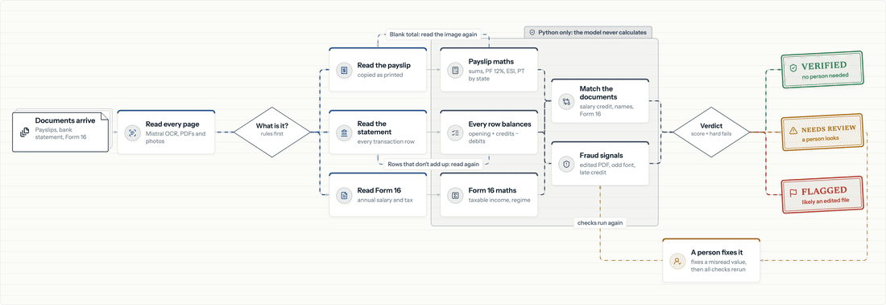

# Loan income verification that shows its working

**Lending · Document AI.** Payslips, a bank statement and Form 16 in. Verified income, FOIR, fraud signals and
a verdict out, in about two minutes. An AI model reads; Python decides.

> **11 / 11** planted fraud cases caught, with no honest file flagged.

## The challenge

Before a salaried borrower gets a loan, an underwriter checks their income by hand. Do the payslips add up?
Did that salary actually reach the bank? Which EMIs are already running? Does Form 16 agree? It takes hours per
file, and edited documents still get through: net pay changed in a PDF editor, a large transfer two days before
the statement ends, a salary that never arrives.

## What I built

> A complete verification service, from upload to signed-off verdict, that a lender could run on their own
> server. Its accuracy was measured on held-out data before any number was shown, and every flag can be traced
> to the page it came from.

## How it works

**1. Read**
- OCR on every page, including scans and phone photos
- A model copies each value exactly as printed and never calculates
- A different model reads again wherever the sums disagree

*Mistral OCR · OpenAI*

**2. Check**
- Payslip maths, PF, ESI and professional tax by state
- The running balance on every bank row
- Salary credits, names and Form 16 matched across documents

*Python*

**3. Catch edits**
- Edited PDFs, odd fonts, late large credits, money in and straight out
- An authenticity score where every point lost has a reason and a page

*Python*

**4. Review**
- The original page beside the values; click one to see it boxed on the page
- Corrections are logged and the whole file is checked again

*React · pdf.js*

## Results

| 11 / 11 | 0 of 19 | 98.9% | $0.05 |
|:---:|:---:|:---:|:---:|
| planted fraud cases caught, across 8 kinds of edit | honest applicants wrongly flagged | of transactions read right on real-layout scans it never saw | per applicant, about two minutes |

*v2, measured on 30 synthetic applicants generated after the last change, plus 30 real-layout scanned bank
statements. Synthetic data only. Full evals and load tests are on GitHub.*

## What I learned

- **"Couldn't read" isn't "tampered".** v1 flagged 2 honest files whose phone-photo payslips lost their totals
  in OCR. Treating blanks as a reason for a person to look, and re-reading them from the image, took that to 0.
- **Real documents find what synthetic ones can't.** Statements that print a time next to each date broke date
  parsing. Only the real-layout set showed it.
- **Still open:** when many files arrive at once, everyone waits for the whole batch. The next fix is finishing
  one file before starting the next.

## Try it

**Live demo** *(coming soon)* · **Video** *(coming soon)* ·
**[Code, evals and load tests](https://github.com/sarthak98765/AI-Agency/tree/main/projects/income-verify)**

React · pdf.js · Node · Express · Python · RabbitMQ · Postgres · Mistral OCR · OpenAI · Langfuse · Docker
